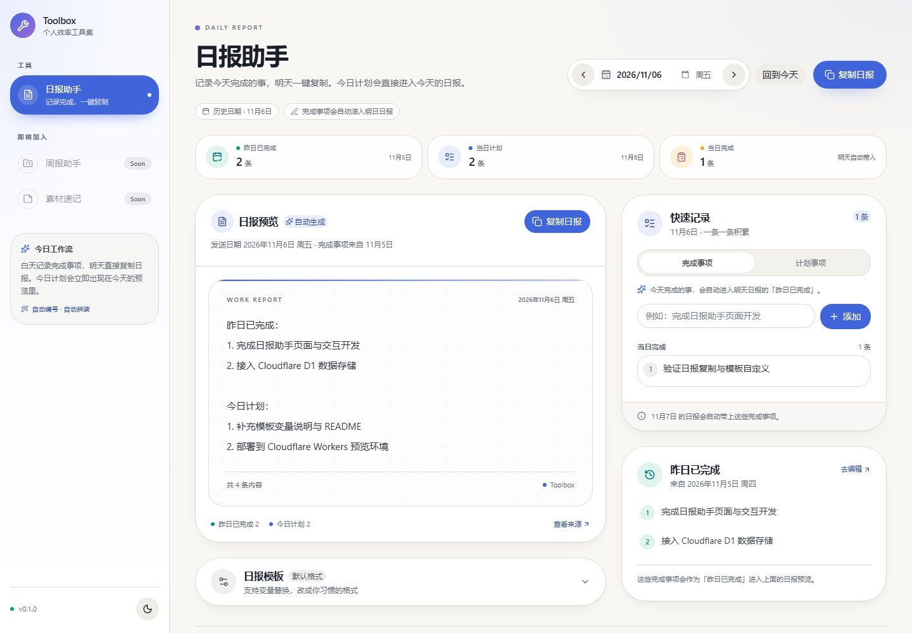

# Toolbox · 日报助手

一个运行在 **Cloudflare Workers** 上的个人效率工具集。第一期只做一件事：白天随手记录完成的事项，第二天一键复制一份格式正确的日报。

> 技术栈：Next.js 16.4 · React 19.3 · HeroUI v3.2 · Tailwind CSS v4 · Cloudflare D1 · OpenNext Cloudflare · Wrangler 4



## 已实现

- **左侧工具导航**：为后续工具预留位置，当前仅启用「日报助手」。
- **按日期查看日报**：支持前后一天、日期选择、回到今天。
- **完成事项记录**：在日期 D 记录完成事项，会自动出现在 D+1 的「昨日已完成」。
- **今日计划**：在日期 D 记录计划事项，会直接进入 D 的「今日计划」。
- **最近记录回退**：如果昨天没有完成记录，会自动向前找最近一次有记录的工作日，并在界面上标注。
- **一键复制**：按模板生成纯文本日报，复制后直接粘贴到工作群。
- **自定义模板**：支持变量、自动编号、短横线列表、日期/星期等。
- **浅色 / 深色主题**：跟随系统，也可以手动切换。
- **数据持久化**：Cloudflare D1，跨设备可用。

## 工作流

假设今天是 11 月 5 日：

1. 在 11 月 5 日的「快速记录」里记下今天完成的事。
2. 在 11 月 5 日的「计划事项」里写下今天的计划。
3. 11 月 5 日的日报预览 = 11 月 4 日的完成事项 + 11 月 5 日的计划。
4. 11 月 6 日打开页面，日报预览 = 11 月 5 日的完成事项 + 11 月 6 日的计划。
5. 点击「复制日报」，去群里粘贴。

日期是「日报要发送的那一天」，不是「记录动作发生的那一天」。所以今天记录完成事项时，它进入的是明天的日报。

## 默认模板

```text
昨日已完成：
{{completed}}

今日计划：
{{planned}}
```

在页面中的「日报模板」里可以随时修改，保存后会立即更新预览。

### 模板变量

| 变量 | 说明 |
| --- | --- |
| `{{completed}}` | 昨日已完成，自动编号 |
| `{{planned}}` | 今日计划，自动编号 |
| `{{completed_plain}}` | 昨日已完成，`-` 开头 |
| `{{planned_plain}}` | 今日计划，`-` 开头 |
| `{{date}}` | 日报日期，例如 `2026-11-06` |
| `{{date_cn}}` | 中文日期，例如 `2026年11月6日` |
| `{{weekday}}` | 星期，例如 `周五` |
| `{{source_date}}` | 完成事项来源日期 |
| `{{completed_count}}` | 完成事项数量 |
| `{{planned_count}}` | 计划事项数量 |

没有内容时，列表变量会渲染为「（暂无）」。

## 本地开发

环境要求：Node.js 20.9+（开发时使用 Node.js 24）。

```bash
npm install

# 可选：复制本地环境变量示例
cp .dev.vars.example .dev.vars

# 初始化本地 D1 数据库
npm run db:migrate:local

# 启动开发服务器
npm run dev
```

打开 <http://localhost:3000>，会自动跳转到 `/daily-report`。

> `npm run dev` 会通过 OpenNext 的 `initOpenNextCloudflareForDev()` 在 Next.js 开发服务器里注入本地 D1 绑定。第一次运行前必须先执行迁移。

### 常用脚本

| 命令 | 作用 |
| --- | --- |
| `npm run dev` | Next.js 开发服务器 |
| `npm run build` | Next.js 生产构建 |
| `npm run typecheck` | TypeScript 检查 |
| `npm run lint` | ESLint |
| `npm run db:migrate:local` | 应用本地 D1 迁移 |
| `npm run db:migrate:remote` | 应用远程 D1 迁移 |
| `npm run preview` | OpenNext 构建 + 本地 Workers 预览 |
| `npm run deploy` | OpenNext 构建 + 部署到 Cloudflare Workers |
| `npm run upload` | 上传新版本但不部署 |
| `npm run cf-typegen` | 根据 Wrangler 配置重新生成绑定类型 |

## 部署到 Cloudflare Workers

### 1. 登录 Cloudflare

```bash
npx wrangler login
```

### 2. 创建 D1 数据库

```bash
npx wrangler d1 create my-tools-db
```

命令会输出一段 `d1_databases` 配置，其中包含真实的 `database_id`。把 `wrangler.jsonc` 里的占位 ID 替换掉：

```jsonc
"d1_databases": [
  {
    "binding": "DB",
    "database_name": "my-tools-db",
    "database_id": "<你的 database_id>",
    "migrations_dir": "migrations"
  }
]
```

如果换了数据库名，也要同步修改 `package.json` 里的 `db:migrate:*` 脚本。

### 3. 初始化远程数据库

```bash
npm run db:migrate:remote
```

### 4. 部署

```bash
npm run deploy
```

部署成功后会得到一个 `https://my-tools.<your-subdomain>.workers.dev` 地址。之后每次发布：

```bash
npm run deploy
```

### 本地 Workers 预览

想验证和线上一致的 Workers 运行时：

```bash
npm run preview
```

`preview` 会重新构建 Worker 并启动本地 Wrangler 服务。数据库使用本地 D1（`.wrangler/state`），不会碰远程数据。

## 项目结构

```text
src/
  app/
    daily-report/
      actions.ts          # Server Actions：新增 / 编辑 / 删除 / 保存模板
      daily-report-screen.tsx
      page.tsx
      error.tsx           # 数据库未初始化时的友好提示
    globals.css           # Tailwind + HeroUI + 主题变量
    layout.tsx
  components/
    app-shell.tsx         # 左侧导航 + 移动端抽屉
    daily-report/         # 日报助手 UI
    providers.tsx         # next-themes + Toast.Provider
  lib/
    daily-report.ts       # D1 查询与日报数据组装
    date.ts               # 上海时区日期工具
    report-template.ts    # 模板渲染与变量
    db.ts                 # D1 绑定
migrations/
  0001_init.sql
wrangler.jsonc
open-next.config.ts
```

## 数据表

```sql
report_items (
  id, item_date, kind, content, sort_order, created_at, updated_at
)

app_settings (
  key, value, updated_at
)
```

- `kind = 'completed'`：某天完成的事项。
- `kind = 'planned'`：某天的计划事项。
- `app_settings` 目前保存 `report_template`。

## 安全说明

这是一个**单用户工具**，没有内置登录。部署到公网后，任何知道 URL 的人都能读写你的数据。

推荐用 **Cloudflare Access（Zero Trust）** 给 Worker 加一层邮箱验证，或者只在本地 / 内网使用。不要直接把包含个人工作内容的地址公开分享。

## 兼容性说明

- **采用稳定版 OpenNext 适配器**：Cloudflare 目前也在推 beta 的 vinext，但本项目选择成熟的 `@opennextjs/cloudflare`，以运行真实的 Next.js 构建产物，降低个人工具的上线风险。
- **Cache Components 已关闭**：Next.js 16 的 Cache Components 在 Workers 运行时下会使用 `setTimeout()`，目前会导致请求挂起。项目保留了 Next.js 16、React 19、Turbopack、Server Actions 等最新能力，只关闭了这一项渲染模式。
- **OpenNext on Windows**：OpenNext 官方声明 Windows 支持不完整。本项目已在 Windows 上完成 `opennextjs-cloudflare build` 和 `wrangler dev` 预览验证；正式部署仍建议在 WSL、Linux 或 GitHub Actions 中执行。
- **无 R2 缓存**：当前页面全部是动态渲染，不需要增量缓存。后续如果启用 ISR / 缓存，可在 `open-next.config.ts` 和 `wrangler.jsonc` 中增加 R2 配置。

## License

Private personal project.
